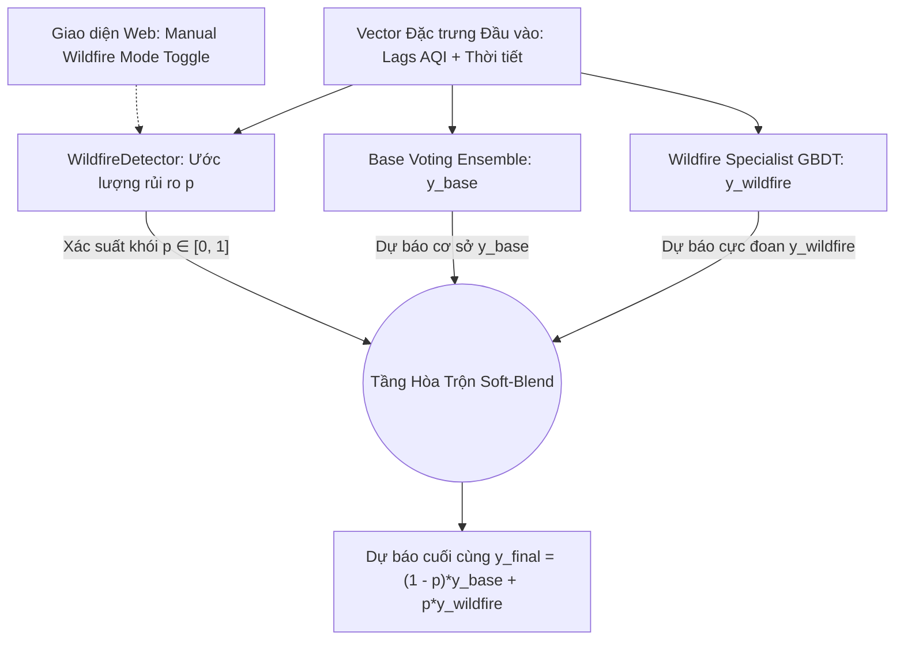

# Đặc Tả Thiết Kế Kỹ Thuật: Tầng Mô Hình Chuyên Biệt Điều Kiện Cháy Rừng (Wildfire Specialist Layer)

> **Dự án:** California AQI Time Series Forecasting Suite  
> **Phiên bản:** 1.0 — Trạng thái: Đã duyệt thiết kế (Design Approved)  
> **Ngày phê duyệt:** 04/11/2026  

---

## 1. Tóm Tắt Mục Tiêu & Phạm Vi (Understanding Summary)
* **Bài toán cần giải quyết:** Các mô hình chuỗi thời gian đối chuẩn (GBDT, Voting Ensemble, MLP, LSTM) gặp hiện tượng *hồi quy về trung bình (regression toward the mean)*, dẫn tới việc đánh giá thấp nghiêm trọng (under-prediction) nồng độ ô nhiễm khi có bão khói thảm họa cháy rừng (AQI > 150 – 500+).
* **Giải pháp:** Bổ sung kiến trúc phân tầng 2 giai đoạn (**Hierarchical 2-Stage / Regime-Switching Mixture of Experts**):
  1. *Gating Mechanism (Wildfire Detector):* Đánh giá xác suất khói cháy rừng $p \in [0, 1]$ từ dữ liệu thời tiết vi khí hậu và sensor trạm quan trắc, hoặc nhận lệnh cưỡng bức từ công tắc thủ công của người dùng.
  2. *Wildfire Specialist Model:* Mô hình Gradient Boosting chuyên biệt tối ưu hàm mất mát phi đối xứng (Asymmetric Extreme Weighting), phạt nặng việc dự báo thấp hơn đỉnh cực đoan.
  3. *Soft-Blend Inference:* Hòa trộn mượt mà kết quả dự báo: $\hat{y} = (1 - p) \cdot \hat{y}_{\text{base}} + p \cdot \hat{y}_{\text{wildfire}}$.
* **Phạm vi thẩm định:** Tập trung trực tiếp vào **các thảm họa cháy rừng 2024–2025** nằm ngoài tập huấn luyện (Out-of-sample Test Set) để chứng minh tính tổng quát hóa không rò rỉ dữ liệu (Zero-shot generalization).

---

## 2. Nhật Ký Quyết Định Thiết Kế (Decision Log)

| ID | Vấn đề | Quyết định được chọn | Các phương án đã cân nhắc | Lý do kỹ thuật |
| :--- | :--- | :--- | :--- | :--- |
| **DEC-01** | **Kiến trúc phân tầng** | 2-Stage Gating (Mixture of Experts) | Single End-to-end Model, Residual Model | Tách biệt hoàn toàn chế độ bình thường và chế độ khói độc hại, không làm suy giảm độ chính xác ngày thường ($AQI \le 100$). |
| **DEC-02** | **Cơ chế kích hoạt** | Hybrid (Tự động + Thủ công) | Hoàn toàn tự động, Chỉ thủ công | Tự động phát hiện theo dữ liệu khí quyển, đồng thời trao quyền override cho chuyên gia qua giao diện Web. |
| **DEC-03** | **Phương thức hòa trộn** | Soft-blend $ (1-p)y_{\text{base}} + py_{\text{fire}} $ | Hard Switch, Residual Offset | Loại bỏ bước nhảy số liệu không liên tục tại ngưỡng chuyển giao giữa 2 trạng thái. |
| **DEC-04** | **Thuật toán Specialist** | Asymmetric-Weighted GBDT | Quantile P90/P95, Deep Multi-head LSTM | Bắt trọn đỉnh cực đoan, suy luận siêu nhanh (< 5ms CPU) và tương thích hoàn toàn với hạ tầng có sẵn. |
| **DEC-05** | **Kiểm chuẩn Out-of-sample** | Thảm họa cháy 2024–2025 (Park, Line, Bridge, Palisades) | Chỉ kiểm tra cháy 2018–2020 | Đảm bảo tính trung thực khoa học: dữ liệu 2024–2025 nằm ngoài tập huấn luyện (Unseen Test). |

---

## 3. Kiến Trúc Kỹ Thuật Chi Tiết

### 3.1. Luồng dữ liệu (Data Pipeline & Inference Flow)

### 3.2. Đặc tả các thành phần

#### A. Khối Nhận diện Khí quyển (Wildfire Detector)
* **Nguyên lý:** Lọc kết hợp (Conjunctive Filter) giữa điều kiện khí tượng gây cháy và gia tốc khói:
  $$\text{Score} = w_1 \cdot \text{VPD} - w_2 \cdot \text{RH} + w_3 \cdot \max(0, \Delta \text{AQI}_{1h}) + w_4 \cdot \text{WindSpeed}$$
  $$p = \frac{1}{1 + e^{-(\text{Score} - \theta)}}$$
* **Quy tắc ghi đè:** Nếu `manual_wildfire_mode == True` $\to p = 1.0$.

#### B. Khối Mô hình Chuyên biệt (Wildfire Specialist)
* **Huấn luyện:** Mô hình LightGBM tối ưu cho 1h Nowcasting và 24h Day-Ahead.
* **Hàm trọng số mẫu:** Phạt nặng lỗi dự báo thiếu ở miền ô nhiễm cao:
  $$w_i = 1.0 + \mathbf{1}_{\{y_i > 100\}} \cdot \left(\frac{y_i}{50}\right)^2$$

#### C. Tích hợp Giao diện (Frontend & API)
* **API Endpoint:** `/api/predict` và `/api/presets` trả về bổ sung các trường:
  * `wildfire_mode_active: bool`
  * `wildfire_prob: float`
  * `wildfire_component_aqi: float`
* **Giao diện người dùng:** 
  * Badge trạng thái cháy rừng: `Wildfire Risk: High / Extreme Smoke`.
  * Công tắc gạt: *“Chế độ Cháy Rừng (Wildfire Specialist)”*.
  * Bộ Presets mới cho các vụ cháy 2024–2025: **Park Fire 2024**, **Line & Bridge Fire 2024**, **Palisades Fire 2025**.

---

## 4. Xử Lý Rủi Ro & Kế Hoạch Nghiệm Thu (Verification Plan)

| Tiêu chí | Mục tiêu định lượng | Phương pháp đo đạc |
| :--- | :--- | :--- |
| **Giảm hụt đỉnh (Peak Under-prediction)** | Giảm $\ge 50\%$ khoảng cách sai số giữa đỉnh thực tế và đỉnh dự báo | So sánh trên đợt cháy Park Fire (07/2024) và Palisades Fire (01/2025). |
| **F1-Score cho AQI > 150 & > 300** | Tăng tối thiểu $+0.10$ đến $+0.25$ điểm F1 | Đánh giá ma trận nhầm lẫn trên toàn bộ tập Unseen Test 2024–2025. |
| **Không suy giảm độ chính xác ngày thường** | $\text{MAE}_{\text{normal}}$ không tăng quá $0.05$ AQI | Kiểm chứng trên tập Test với những ngày không có cháy rừng ($p \to 0$). |
| **Độ trễ suy luận API** | $\le 50\text{ms}$ trên CPU thông thường | Đo thời gian xử lý của endpoint `/api/predict`. |
| **Cơ chế suy giảm an toàn (Fallback)** | Không crash hệ thống khi thiếu file hoặc dữ liệu NaN | Fallback an toàn về Base Ensemble $p = 0$. |

